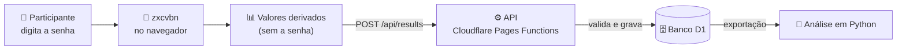

<div align="center">

# 🔐 Pesquisa sobre Força de Senhas

**Instrumento de coleta do TCC _"Um estudo de caso sobre a força das senhas dos estudantes da PUC Minas Campus Contagem"_**

Bacharelado em Sistemas de Informação · PUC Minas Contagem

[](https://pesquisa-senhas-pucminas.pages.dev)


</div>

---

## 📖 Sobre

Esta página avalia a força de uma senha com o estimador [zxcvbn](https://github.com/dropbox/zxcvbn), desenvolvido pelo Dropbox, **diretamente no navegador do participante**. A senha nunca é transmitida nem armazenada: apenas valores derivados, que não permitem reconstruí-la, são enviados para a pesquisa.

O código é aberto justamente para que qualquer participante possa conferir isso.

## 🛡️ Privacidade

| ✅ Enviado à pesquisa | ❌ Nunca enviado nem armazenado |
|---|---|
| *Score* do zxcvbn (0 a 4) | A senha |
| Log₁₀ do número estimado de tentativas | Nome, e-mail ou login |
| Comprimento da senha | Endereço IP |
| Presença de minúsculas, maiúsculas, números e símbolos | Cookies ou armazenamento local |
| Tipos de padrão detectados (dicionário, sequência, repetição, teclado, data ou nenhum) | Qualquer dado do dispositivo |
| Data e hora do envio | |

Como isso é garantido:

- **A análise é local.** O zxcvbn roda em JavaScript no próprio navegador ([`public/zxcvbn.js`](public/zxcvbn.js)), hospedado junto com a página, sem CDN.
- **A página só pode falar com o próprio domínio.** A política de segurança de conteúdo em [`public/_headers`](public/_headers) bloqueia qualquer conexão com outros servidores.
- **A API só aceita os campos acima.** [`functions/api/results.js`](functions/api/results.js) recusa qualquer campo extra ou valor fora do esperado, e não permite leitura dos dados.
- **Um envio por acesso.** O resultado só é calculado no momento do envio, e o campo da senha é apagado em seguida.

## 🧭 Como funciona



## 📁 Estrutura

```
pesquisa-senhas-pucminas/
├── public/                   # página estática (publicada na Cloudflare)
│   ├── index.html            # página da pesquisa
│   ├── zxcvbn.js             # estimador zxcvbn 4.4.2
│   └── _headers              # cabeçalhos de segurança (CSP)
├── functions/api/
│   └── results.js            # API: POST /api/results
├── scripts/
│   ├── export_results.py     # converte a exportação do banco em CSV
│   ├── analyze_results.py    # análise estatística
│   └── requirements.txt
├── schema.sql                # tabela do banco D1
└── wrangler.toml             # configuração da Cloudflare
```

## 🚀 Publicação

> Pré-requisitos: [Node.js LTS](https://nodejs.org/) e uma conta gratuita na [Cloudflare](https://dash.cloudflare.com/sign-up).
> No PowerShell do Windows, use `npx.cmd` em vez de `npx`.

```powershell
# 1. Entrar na conta Cloudflare
npx.cmd wrangler login

# 2. Criar o banco (copie o database_id exibido para o wrangler.toml)
npx.cmd wrangler d1 create pesquisa-senhas-pucminas-db

# 3. Criar a tabela
npx.cmd wrangler d1 execute pesquisa-senhas-pucminas-db --remote --file=schema.sql

# 4. Publicar página + API
npx.cmd wrangler pages deploy
```

O site fica disponível em **https://pesquisa-senhas-pucminas.pages.dev**. Na primeira publicação, o certificado HTTPS pode levar alguns minutos para ficar pronto.

<details>
<summary><b>Testar localmente antes de publicar</b></summary>

```powershell
npx.cmd wrangler d1 execute pesquisa-senhas-pucminas-db --local --file=schema.sql
npx.cmd wrangler pages dev
```

Acesse `http://localhost:8788`. Os envios vão para um banco local, separado do banco de produção.
</details>

## 📊 Coleta e análise

**Acompanhar o número de respostas:**

```powershell
npx.cmd wrangler d1 execute pesquisa-senhas-pucminas-db --remote --command "SELECT COUNT(*) AS total FROM responses"
```

**Exportar e analisar ao final da coleta:**

```powershell
npx.cmd wrangler d1 execute pesquisa-senhas-pucminas-db --remote --json --command "SELECT * FROM responses ORDER BY id" > export.json
pip install -r scripts/requirements.txt
python scripts/export_results.py export.json
python scripts/analyze_results.py
```

A pasta `output/` recebe o relatório (`analysis_report.txt`), as tabelas em CSV, a tabela de frequência em LaTeX e o gráfico da distribuição dos *scores*. Os dados exportados não são versionados (veja o [`.gitignore`](.gitignore)).

**Análise realizada:** distribuição de frequência, mediana, quartis e moda dos *scores*; proporções de senhas fracas e fortes com intervalo de confiança de 95% (Wilson); tempo estimado de quebra nos quatro cenários do zxcvbn; correlação de Spearman, teste U de Mann-Whitney e teste exato de Fisher, com tamanho de efeito.

## 👥 Autoria

- **Matheus Yuri Benicio Rios**, autor · [@matheusyuribr](https://github.com/matheusyuribr)
- **Prof. Paulo Henrique Rodrigues**, orientador

## 📄 Licença

Código sob a licença [MIT](LICENSE). O zxcvbn é © Dan Wheeler e Dropbox, Inc., também sob a licença MIT (veja [`THIRD_PARTY_NOTICES.md`](THIRD_PARTY_NOTICES.md)).
